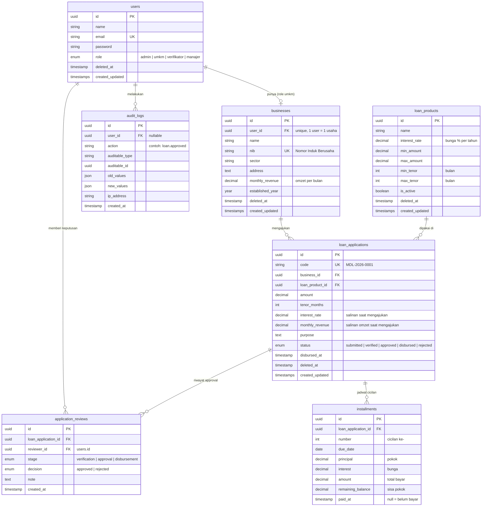
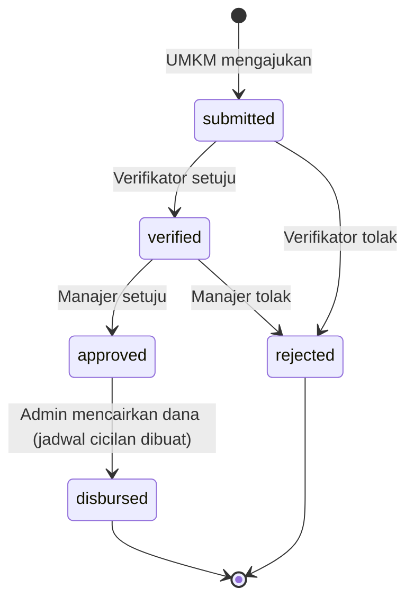

# ERD Modalin

Rancangan database untuk **Modalin**, platform pengajuan pembiayaan UMKM.
Semua primary key memakai **UUID**. Tabel bertanda `deleted_at` memakai **soft delete**.



## Alur status pengajuan



Setiap perpindahan status menyimpan satu baris di `application_reviews` (untuk timeline) dan satu baris di `audit_logs`.

## Aturan bisnis

| Aturan | Di mana dicek |
| --- | --- |
| Plafon maksimal **3x omzet bulanan** (`amount <= monthly_revenue * 3`) | Form Request pengajuan |
| `amount` dan `tenor_months` harus di dalam batas `loan_products` | Form Request pengajuan |
| UMKM hanya boleh punya **1 pengajuan aktif** (status `submitted`, `verified`, atau `approved`) | Form Request pengajuan |
| Tiap role hanya bisa memproses tahapnya sendiri | Policy |
| Bunga dan omzet **disalin** ke pengajuan, supaya perubahan produk atau profil usaha tidak mengubah pengajuan lama | Saat create |

## Rumus cicilan (anuitas)

```
r = interest_rate / 12 / 100        bunga per bulan
M = P * r / (1 - (1 + r)^-n)        cicilan tetap per bulan

Untuk tiap bulan:
  bunga   = sisa_pokok * r
  pokok   = M - bunga
  sisa    = sisa_pokok - pokok
```

`P` = jumlah pinjaman, `n` = tenor (bulan). Selisih pembulatan ditaruh di cicilan terakhir supaya sisa pokok tepat 0.

## Catatan untuk murid

- **Sanctum + UUID:** migration bawaan `personal_access_tokens` memakai `morphs('tokenable')` (bigint). Karena `users.id` adalah UUID, ganti menjadi `uuidMorphs('tokenable')`. Kalau lupa, login akan gagal.
- `application_reviews`, `installments`, dan `audit_logs` **tidak** memakai soft delete karena isinya riwayat yang tidak boleh diubah.
